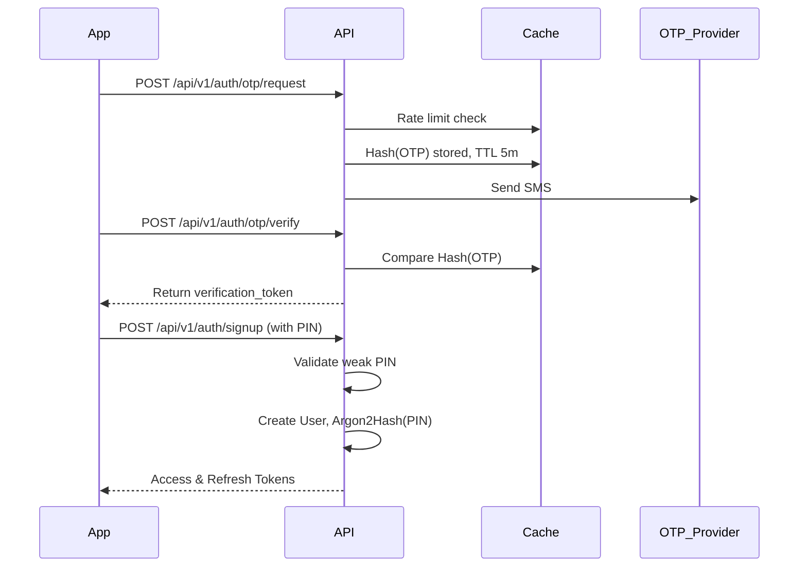

# Skyjumpers Authentication & Identity

## Models
- **User**: Custom Django user keyed strictly by E.164 phone number. Primary key is UUID. PIN is hashed via `Argon2id`.
- **Device**: Tracks user devices and whether they require step-up authentication.
- **RefreshTokens**: Standard JWT family rotation model to prevent token theft.

## Flow: Signup & New Device Login

## Threat Model
| Threat | Mitigation | Residual Risk |
|---|---|---|
| Brute force PIN | Max 5 attempts then progressive lockout up to 24h. | Low. Lockout protects account. |
| OTP Spamming | 3 per 15m, 10 per day, 30s cooldown. | Low. Provider cost contained. |
| Account Enum. | `invalid_credentials` identical on wrong phone or wrong PIN. | Low. Timing attacks mitigated by hash cost. |
| Token Theft | Refresh token rotation. Reuse revokes entire family. | Low. Requires step-up auth on new device anyway. |
| DB Dump Theft | PINs use Argon2id, tokens are hashed, UUID PKs. | Medium. Need DB encryption at rest. |
